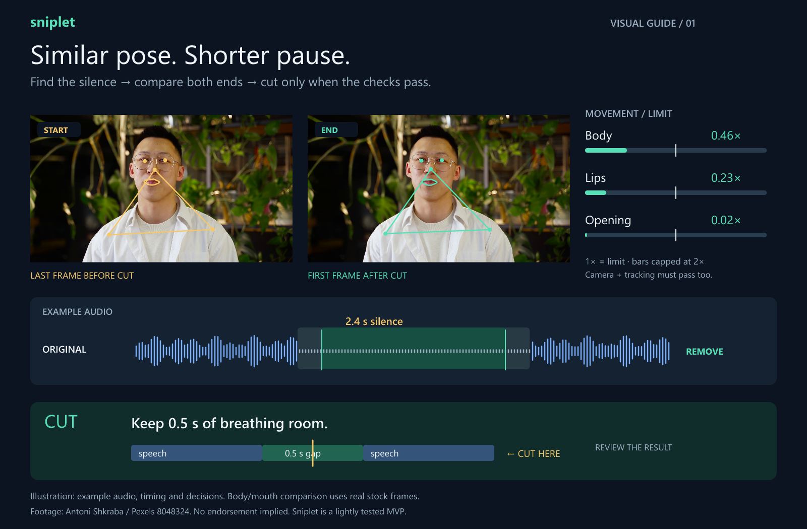
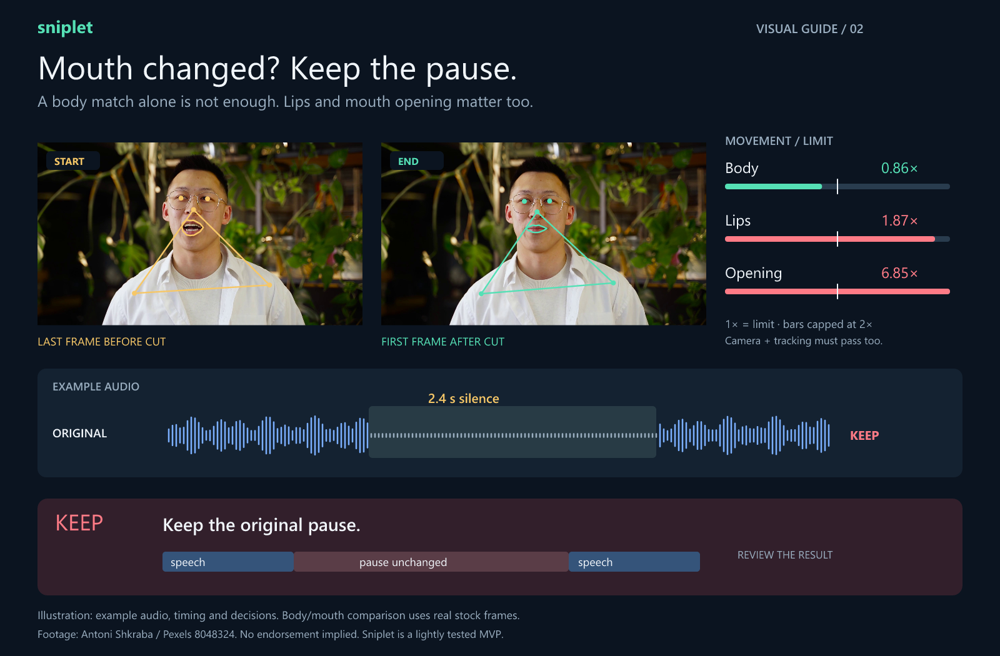
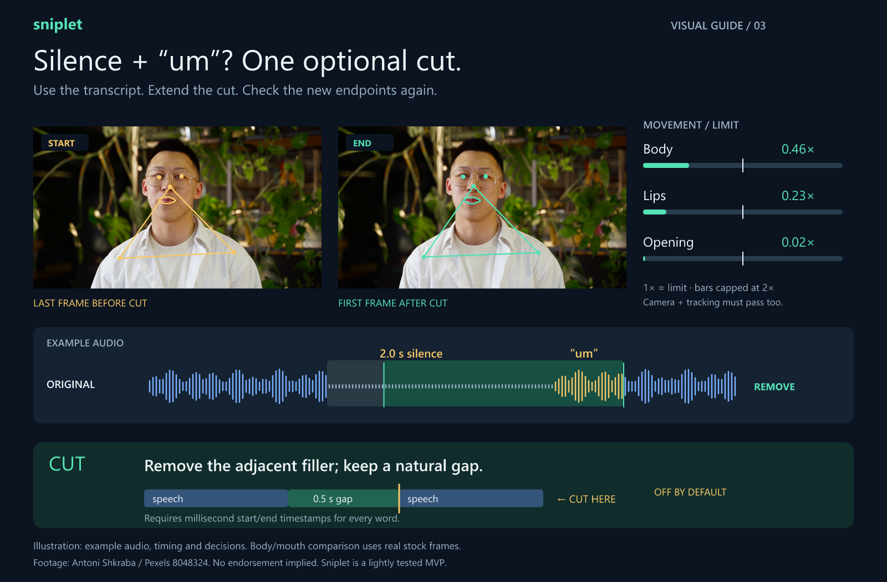

# Sniplet

Shorten long pauses without blindly creating jump cuts.

Sniplet helps short-form editors remove silence only when the speaker's body and mouth are in similar positions at the cut. It checks for camera movement, keeps a natural breathing gap, and leaves uncertain cuts alone.

**MVP — very little real-world testing.** The logic is implemented, but thresholds and edge cases may need tweaking. Always watch and listen to the result before publishing. A passing check does not guarantee an invisible cut.

## Quick start

Requires Python 3.10–3.12 and FFmpeg (`ffmpeg` and `ffprobe` on PATH). Download this repository, open a terminal in its folder, and install in a virtual environment:

```sh
python -m venv .venv
# Windows: .venv\Scripts\activate
# macOS/Linux: source .venv/bin/activate
python -m pip install .
sniplet input.mp4 -o edited.mp4
```

Use stationary, single-person shots. The tool writes a separate video and a JSON decision report; it refuses to overwrite existing files. `--analyze-only` writes the report without rendering.

## Optional: include nearby fillers

Disabled by default. Supply a transcript to consider **um, uh, erm, er** immediately before or after a detected silence:

```sh
sniplet input.mp4 -o edited.mp4 --transcript words.srt
```

**Export at maximum granularity: every single word needs its own start and end timestamps with millisecond precision.** Use a word-level SRT/VTT or the JSON format in [examples/words.json](examples/words.json). The transcript must match the exact input video's timeline. Paragraph timestamps and sentence-level subtitles are rejected; adding decimal places to coarse timestamps does not make them accurate. If your Descript export groups words, obtain a word-timed export before using this feature.

This uses written transcript words, not speech recognition. It only extends a silence cut, checks the new endpoints again, and falls back to the silence-only cut if needed. It never removes standalone fillers. Ambiguous responses such as “hmm,” “huh” and “mm-hmm” are excluded by default; opt in with `--fillers um,uh,erm,er,hmm` if appropriate.

## How decisions work

1. Find pauses of at least 0.85 seconds below −34 dBFS, longest first.
2. Keep at least 0.5 seconds of the original silence: normally 0.25 seconds on each side. Filler extensions preserve the full gap on the opposite side.
3. Compare the last retained frame and first retained frame: face, shoulders, visible wrists and lips. Check sampled background movement and single-face visibility.
4. Cut only if every required check passes. Missing tracking or uncertain background means keep.

Adjust `--min-silence`, `--noise-db`, `--keep-gap` or `--motion-scale`; run `sniplet --help` for details. Larger motion scales allow more visible movement. Reports include measurements, skipped candidates and exact cut times.

## Limits and development

Designed for ordinary constant-frame-rate SDR talking-head footage with audio. Moving cameras, wide/two-person shots, occlusion, poorly lit faces and busy backgrounds are unsuitable. Face detection can miss people; camera checks are sampled heuristics. Hidden hands are not assessed. Music/noise can confuse silence detection. Only the first audio stream is used; output is H.264/AAC. No GUI or editor integration yet.

Tests cover timing, filler adjacency, conservative fallback and rendering; real-footage validation is limited. Run `python -m unittest discover -s tests`. Contributions and threshold improvements are welcome. MIT licensed. Uses FFmpeg, OpenCV and MediaPipe; their own licenses apply.

## Visual guide



<details>
<summary>See a rejected cut and optional filler trimming</summary>





</details>

Illustrative audio and timings; real stock frames and landmark comparisons. [Source, license and image files](visuals/README_Visuals.md).
